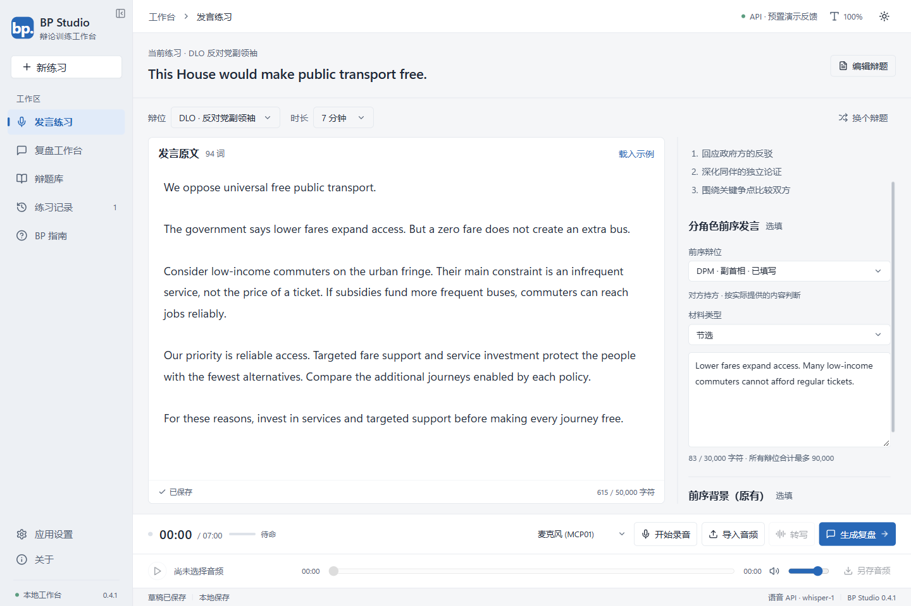
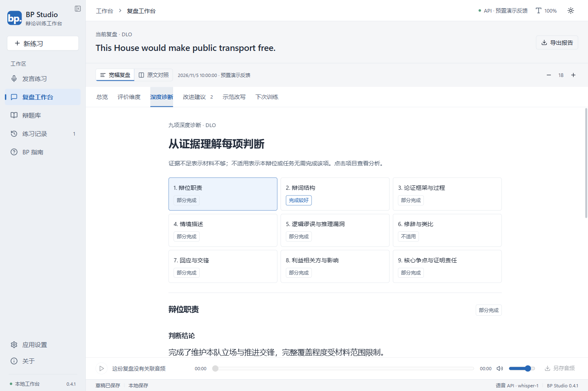
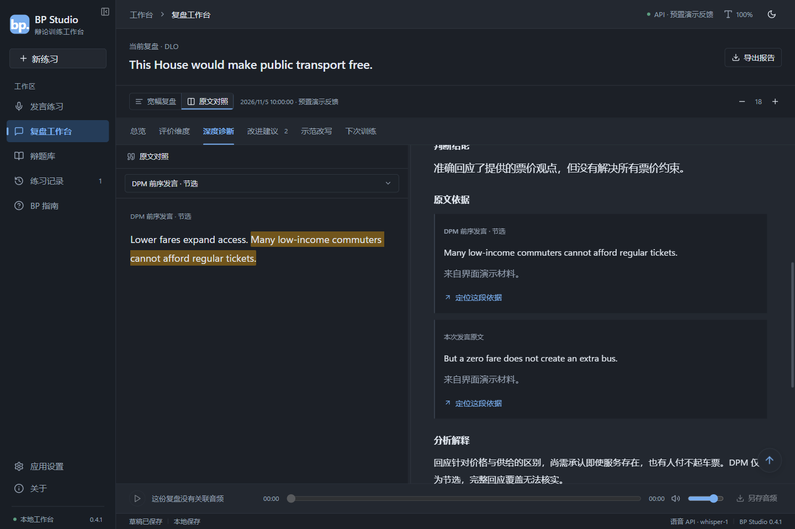
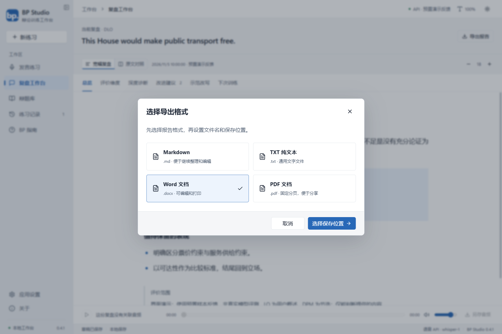

# BP Studio · BP辩论训练工作台

面向 British Parliamentary（英国议会制，BP）辩论练习的 Windows 桌面工具，将**发言练习、音频转写、AI 教练反馈、九项深度诊断与报告导出**放在同一个工作台中。

**当前版本：0.4.1 · Windows x64 · 制作者：少数派memetics**

[下载最新便携版](https://github.com/memetics1980/BP-Studio/releases/latest) · [快速上手](docs/使用指南.md) · [从源码构建](docs/开发与验证.md) · [版本说明](CHANGELOG.md)

> 图片使用预置的演示发言和样本反馈展示界面，不代表真实学生表现，也不是模型评价准确性的实测结果。

## 从一次发言到一份可执行的复盘

1. **准备发言**：选择辩题、八个 BP 辩位之一，以及 3、5 或 7 分钟训练时长。
2. **录音或输入文字**：支持麦克风录音、音频导入与直接编辑发言原文。内置 Whisper Base 可离线转写。
3. **补充前序材料**：按辩位填写完整原文、节选或用户概述，也可沿用背景输入框。切换当前辩位会保留已填材料；只有更早辩位参与本次分析。
4. **生成教练反馈**：连接本机 Ollama，或使用兼容 OpenAI 格式的 API。保留五项评价、优点、改进建议、示范改写和下次训练，另提供九项深度诊断。
5. **对照和复练**：点击依据切换到对应原文并高亮；根据优先改进点修改，再导出复盘报告。

## 九项深度诊断

每项包含完成状态、判断结论、原文依据、分析解释、对说服力的影响和具体修改建议，并可按任务、论点或利益相关方展开。

| 项目 | 关注内容 |
| --- | --- |
| 辩位职责 | 是否完成所选辩位的必要任务，是否偏离角色职责 |
| 辩词结构 | 立场、组织、展开、衔接和收束是否清楚，是否适合本辩位 |
| 论证框架与过程 | 判断标准、前提、机制、影响和比较是否形成合理推理链 |
| 情境描述 characterization | 行动者的动机、能力、约束与制度背景是否得到必要说明 |
| 逻辑谬误与推理漏洞 | 具体推理是否存在明确问题或待核实风险，如何修复 |
| 修辞与类比 | 类比、比喻或情绪诉求是否恰当，是否需要独立证明 |
| 回应与交锋 | 是否准确回应提供的对方观点，是否仍有关键缺口 |
| 利益相关方与影响 | 关键群体、内部差异、行为变化与收益损失如何分配 |
| 核心争点与证明责任 | 是否抓住本方需要证明的核心问题，并完成实质论证 |

状态区分**完成较好、部分完成、未完成、证据不足、不适用**。缺少材料不能自动判定为没有完成任务；合理的不同立论路径也不应被单一标准答案排除。模型可能判断失误，使用者仍应结合原文核对。

## 让反馈可以回到原文

- 根据证据来源区分本次发言、指定前序辩位与背景，点击即可切换并高亮。
- 概述明确标注为用户概述；无法在标注来源中核实的引文会提示核对。
- 原文与反馈可独立滚动；反馈向下超过 300 像素后显示回到顶部箭头。
- 旧记录可继续读取与导出；未包含新诊断的旧记录不会被自动补评。

## 四种报告格式

导出时先选择 **Markdown、TXT、Word 或 PDF**，再选择文件名与保存位置。报告包含原有反馈、分角色材料、九项诊断、证据来源及评价范围。

- Word 可继续编辑；PDF 支持选择文字并固定分页。
- 报告导出不依赖 Microsoft Office、打印机或用户自己的 Python 环境。
- 复盘页、练习记录和 `Ctrl+E` 使用同一套导出流程。

## 下载与运行

前往 [Releases](https://github.com/memetics1980/BP-Studio/releases/latest) 下载最新 ZIP，**完整解压后双击 `BPStudio.exe`**。请保留同目录的 DLL、`speech`、`webview-runtime` 和 `wwwroot`，不要在压缩包预览窗口直接运行。

| 项目 | 说明 |
| --- | --- |
| 系统 | Windows x64；本地验证环境为 Windows 11 |
| 便携包 | 随附 .NET、WebView2、专用 Python/音频解码环境及 Whisper Base |
| 本地转写 | 首次自动离线准备 Base；无需另装 Python、FFmpeg 或上述运行环境 |
| AI 教练 | 需要用户配置 Ollama 或兼容 API；便携包不含大语言模型、API Key 或服务额度 |
| 较大语音模型 | 在设置中自行选择下载；Base 可直接用于日常训练 |
| 磁盘空间 | 为完整解压与首次语音准备预留合计约 2 GB 空间 |

## 数据与评价范围

- 草稿、设置及复盘保存在本机 `%APPDATA%\bp-studio-native`；语音资源位于 `%LOCALAPPDATA%\BPStudio\speech\managed`。
- API Key 使用 Windows 当前账户加密保存。使用远程反馈或转写服务时，所需材料会发送到用户配置的服务。
- 音频导入不会自动上传；反馈依据用户提供的辩题、文字及前序材料。
- 五项 1–5 分用于形成性训练，**不是 WUDC 正式赛事分数或全场排名**。仅凭文字不能评价口音、发音或声线。
- 公开仓库和 Release 不包含开发者账号、真实学生资料、密钥或个人练习记录。

## 项目与验证

本仓库以一个当前版本源码快照起步，首次发布只提供 **v0.4.1**，不导入旧版发布包或开发提交历史。便携 ZIP 和校验文件通过 Release 提供，运行环境与模型不放进 Git 源码历史。

桌面端采用 **WPF + WebView2 + React/TypeScript**，核心逻辑使用 **.NET 8**。验证覆盖反馈结构、证据定位、新旧数据兼容、报告导出、回到顶部及便携启动；AI 接口流程使用本机合成反馈验证，未宣称真实模型教学评价质量已通过评测。详情见 [开发与验证](docs/开发与验证.md)。

第三方组件及语音模型适用各自许可，见 [桌面组件说明](THIRD_PARTY_DESKTOP.md)、[语音组件说明](THIRD_PARTY_SPEECH.md) 和 [许可副本](licenses/)。

问题或建议可通过 [Issues](https://github.com/memetics1980/BP-Studio/issues) 提交；请勿在公开问题中附上 API Key 或真实学生资料。
